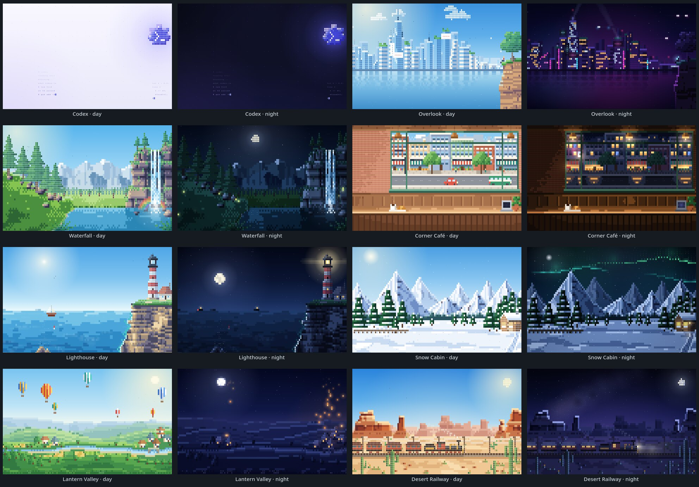

# Codex Themes

Animated ASCII wallpapers for Codex on macOS, with a theme switcher in the
sidebar and a `/theme` picker in the composer. Each wallpaper is a live scene
painted in glyph tiles, with a day and a night version that follow Codex's
light and dark appearance.



An unofficial add-on. Nothing inside the ChatGPT app is modified (see
[How it works](#how-it-works)).

## Install

You need macOS 13 or later and the
[ChatGPT desktop app](https://chatgpt.com/features/desktop/), which includes
Codex (it replaced the Codex app; ChatGPT Classic isn't supported).

Paste this into Terminal:

```sh
curl -fsSL https://raw.githubusercontent.com/satellitedown/codex-themes/master/install.sh | bash
```

It downloads the latest [release](https://github.com/satellitedown/codex-themes/releases/latest),
installs **Codex Themes** into Applications and opens it. If Codex is already
running, Codex Themes asks to restart it once. ([Read the script](install.sh)
before running it if you like.)

From then on, open **Codex Themes** instead of Codex; put it in the Dock in
Codex's place. It starts Codex with wallpapers and quits when Codex quits.

**Update:** run the same command again.

**Uninstall:**

```sh
curl -fsSL https://raw.githubusercontent.com/satellitedown/codex-themes/master/install.sh | bash -s -- --uninstall
```

Open Codex windows keep their wallpaper until you quit and reopen Codex.

### Other ways to install

**Manual download.** Download `Codex-Themes.zip` from the
[latest release](https://github.com/satellitedown/codex-themes/releases/latest),
unzip it and move **Codex Themes** into Applications. The app isn't notarized
by Apple, so macOS blocks the first launch of a browser download: open
**System Settings → Privacy & Security** and click **Open Anyway**. (The
Terminal installer doesn't hit this, because files fetched with `curl` aren't
quarantined.)

**From source.** Requires Node.js 22+ and the Xcode Command Line Tools
(`xcode-select --install`):

```sh
git clone https://github.com/satellitedown/codex-themes.git
cd codex-themes
scripts/build-app.sh
./install.sh --zip dist/Codex-Themes.zip
```

Release builds are made the same way by
[GitHub Actions](.github/workflows/release.yml).

## Use

- Pick a wallpaper from the **Wallpaper** previews at the bottom of the sidebar
  (hover to play one); **Off** turns it off. **Day / Night** below the previews
  switches Codex between its light and dark appearance (the same setting as
  Settings → Appearance), and each wallpaper follows with its day or night scene.
- Type `/theme` in any composer, or press **⌘⌥T**.
- **← →** preview a theme in the real wallpaper, **↵** applies it and **esc** reverts.
- Clicking a card applies it right away.
- `/theme lantern`, `/theme 4` or `/theme off` select a theme directly; **↵** applies it.

The choice is saved in Codex's own storage and syncs across Codex windows.
With Codex set to follow the system appearance and macOS set to Auto, the
wallpaper changes over to night at sunset.

## Themes

| Theme | Day | Night |
|---|---|---|
| Codex | Codex blossom with a blinking `>_` on pale lavender, ghost code typing itself | The same on deep indigo |
| Overlook | Grassy cliff and lone tree over a glass skyline across the bay | Cyberpunk skyline: neon signs, flying cars, searchlights, reflections |
| Waterfall | Falls pouring from a layered cliff, rainbow in the spray, pines and snowy peaks | Moonlit falls, stars, fireflies over the meadow |
| Corner Café | Sunny street through the café window; cars, a bus and bikes pass | Rain on the glass, lit shop windows, neon OPEN, headlights |
| Lighthouse | Striped lighthouse on a rocky headland, sailboat, gulls, surf | Sweeping beam, moon glitter on the sea, ship lights |
| Snow Cabin | Cabin among snowy pines and peaks, chimney smoke, snowfall | Aurora curtains, moonlit snow, warm windows |
| Lantern Valley | Striped hot-air balloons over rolling hills and a river village | Paper lanterns rising from the village among the stars |
| Desert Railway | Red mesas, saguaros, a steam train rolling through | Milky Way, full moon, lit coaches and a headlight |

## How it works

The ChatGPT app is a Chromium/Electron app whose bundle is code-signed and
integrity checked, so nothing inside `ChatGPT.app` is modified. Instead:

1. `macos/CodexThemes.swift` (the launcher) opens Codex with
   `--remote-debugging-port=<random free port>`.
2. It connects over the Chrome DevTools Protocol, attaches to each Codex window,
   and registers `dist/codex-themes.js` to run on every page load. Utility
   windows (quick ask, pet overlay) are skipped.
3. The engine (`src/`) draws the scene on a canvas behind Codex's UI. Its CSS
   makes the window shell transparent, puts frosted strips behind the sidebar
   and the conversation (the sidebar has no panel of its own, so it sits on
   the scene like the chat does), turns the composer and settings panels into
   tinted glass, retints menus and popovers to the theme, and adds the picker
   and the sidebar switcher.

Per frame, a scene writes cells into a `Field` (tile, bare glyph or solid
block, with ink and opacity). The renderer blits them from a pre-rendered glyph
atlas, and static scenery is pre-rendered once per resize. It runs at 30 fps
when focused and 12 fps in the background, stops when the window is hidden,
and draws a still frame when reduced motion is on. Tiles behind the
conversation column and the sidebar are drawn faint so text stays readable.

## Develop

```sh
npm install
npm run watch                               # rebuild dist/codex-themes.js on change
node scripts/inject.mjs --watch             # on the Mac: re-inject into the running Codex
```

`inject.mjs` reads the debug port from the running Codex process, or takes
`--port N`. A re-injected build replaces the running one in place. Themes live
in `src/themes/`; the contract is documented in `src/themes/index.js`.

To work on scenes without Codex, render them with headless Chromium (or Chrome;
set `CHROME` to pick a binary):

```sh
npm run preview -- waterfall --out /tmp/preview   # day + night, framed like the app
npm run preview -- --raw --size 1920x1080         # every theme, scene only
```

The default frame mimics the app: reading areas dimmed, frosted strips behind
the sidebar and chat, the glass composer, and sample text. Options:
`--scheme light|dark|both`, `--time <seconds>`, `--size WxH`, `--dpr N`,
`--raw`, `--out <dir>`.

### Releasing

Bump `version` in `package.json`, commit, then tag and push:

```sh
git tag v0.2.0 && git push origin v0.2.0
```

The [Release workflow](.github/workflows/release.yml) builds the app on macOS
and publishes `Codex-Themes.zip`; `install.sh` installs the latest release.

## Caveats

- Themes appear only when Codex was opened through Codex Themes. If Codex
  relaunches itself (for example after an update), open Codex Themes again.
- While Codex runs with themes, its DevTools port accepts connections from
  local processes. It is bound to 127.0.0.1 and closes when Codex quits.
- Styling hooks rely on Codex's current markup (composer and surface CSS
  variables, sidebar and layout class names). A Codex update can break the
  glass styling until it is adjusted here.
- Day / Night writes Codex's appearance setting through Codex's internal
  settings service. If an update moves that service, the switch hides itself;
  Settings → Appearance keeps working.
- The app is ad-hoc signed, not notarized (see Manual download above).
- Log: `~/Library/Logs/CodexThemes.log`.

## Credits

Inspired by Marko Vineli's ([@handsher_NGU](https://x.com/handsher_NGU)) fan
concept of live ASCII wallpapers. The scenes here are original.
